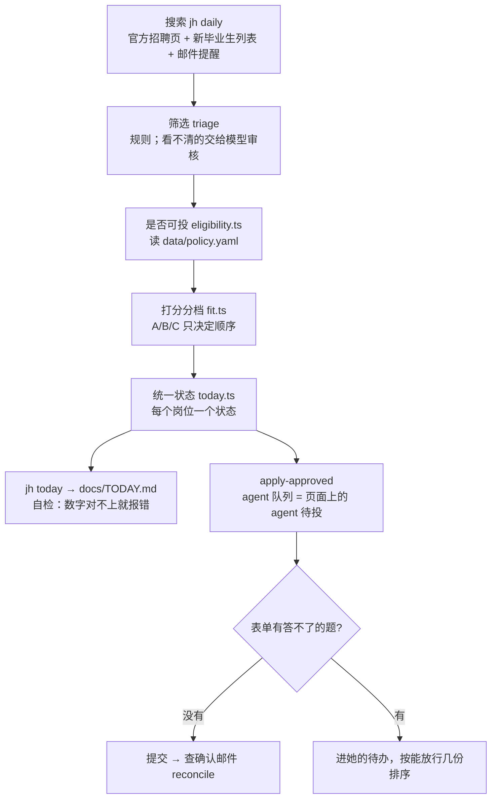

# 交接：jobhunt-agent v3（2026-11-02）

给接手的 agent。**先读完这份，再读 `CLAUDE.md`、`ARCHITECTURE.md`、`docs/DESIGN-v3.md`，然后用 `/poteto-mode` 开始工作。** 不要靠旧的交接文档或聊天记录推断候选人的决定；以本文第四节和 `data/policy.yaml` 为准。

上一个 agent 的会话超过几百轮，后期反复出错：重复问已答过的问题、报了没核对的数字、同一件事两套逻辑。候选人因此要求换新 agent。你的首要任务不是多投几份，而是**让候选人不用逐条检查就能相信你的工作**。

---

## 一、目标与阶段

**最终目标**：候选人拿到一份能办 H-1B 的工作（她是 F-1 OPT，需要 sponsorship）。

| 阶段 | 内容 | 状态 |
|---|---|---|
| **1. 海投（按优先级）** | 1a 搜全：每天新发的岗位都要搜到；1b 筛对：只留适合她的、公司办 H-1B 的；1c 投出：最对口的先投、新发的先投 | **现在在这里，1a 还没做完** |
| 2. 中小公司外联 | 给中小公司的招聘方/创始人写冷邮件（放她的 Gmail 草稿箱，她自己发） | 这个阶段**不做**，但**数据要一直保存**（见下） |
| 3. 跟进 | 识别拒信、面试邀请，按结果校准打分 | 不做，等投几天再说 |

**数据要为后面的阶段保存**：每次搜索的全部岗位（包括不投的、超过 30 天的、中小公司的）都留在 `data/discovery/catalog.jsonl`（git 里存 `.gz`）。外联候选公司在 `docs/reports/<日期>/outreach.csv|json`。不要删数据，不投的只是不投。

---

## 二、架构

### 多 agent 组织（`ARCHITECTURE.md`「Agent organization」）

```
coordinator（总协调：调度、预算、每日页面、待办）
├─ discovery manager（搜索）
│   ├─ workers：各来源抓取（代码）、邮件提醒解析、筛选（规则 + 模型审核）
│   └─ verifier：盲审 agent，用另一个模型，只看岗位原文，给筛选打分（误选率、漏选率）
├─ apply manager（投递）
│   ├─ workers：填表流程（代码）、问题→事实映射（模型）、ATS 适配器修复
│   └─ verifiers：答案审核（每个答案能追溯到她的资料）、提交审核（证据 vs 计划 vs 资料）
└─ outreach manager（外联，第 2 阶段）
    ├─ worker：招聘联系人研究
    └─ verifier：来源与日期核对
```

核心规则（原文要点）：
- 只有**输出能被验证**的地方，agent 才可以无人值守地干。
- 审核者必须**独立**：不同的模型或提示，读原始材料，不读 worker 的总结。
- 每个环节有可信度等级（`data/trust.json`）：审核误差超过 10% 自动降级；只有候选人能升级。
- 每个被发现的错误都要变成规则、测试或适配器修复，**不靠人第二次抓**。

### 数据流（v3）



关键文件：
| 做什么 | 在哪 |
|---|---|
| 她的所有"投什么"的决定 | `data/policy.yaml` |
| 是否可投（唯一的判断，纯函数） | `src/discover/eligibility.ts` |
| 每个岗位的唯一状态、agent 队列、每日页面 | `src/discover/today.ts`，CLI `jh today` |
| 对口打分 | `src/discover/fit.ts`（关键词在 `policy.yaml` 的 `fit`） |
| H-1B 记录 | `src/discover/h1b.ts`（判断）、`src/sources/h1b.ts`（查 h1bdata.info）、缓存 `data/h1b/sponsors.json` |
| 答题规则 | `src/plan/rules.ts`（逐题型规则）、`data/answers.yaml`（她的原话答案） |
| 问题→事实映射 | `src/plan/facts.ts`、`data/question-map.jsonl`，CLI `jh facts-map --out/--from` |
| 投递记录（她的文件，只追加） | `data/ledger.jsonl` |
| 决策记录（只追加；2026-11-02 下午才开始记，之前的决定只在本文和提交记录里） | `docs/decisions.tsv` |

每天怎么跑（候选人每天会来说一声，**不设定时任务**，直到系统稳定、她同意）：
```
npm run day          # 搜索 → 查 H-1B → 对账 → 生成 docs/TODAY.md（不投递）
npm run day:apply    # 投 agent 队列 → 对账 → 生成页面
```

---

## 三、最重要的：怎么让候选人信任你（pstack）

pstack 的 skill 已放进 `.claude/skills/`（MIT，来源 github.com/cursor/plugins/tree/main/pstack）。**每个任务用 `/poteto-mode`。** 先完整读 `.claude/skills/poteto-mode/SKILL.md` 和它列出的原则。

上一个 agent 失败的方式，和对应的原则：
| 失败 | 原则 | 以后必须这样做 |
|---|---|---|
| 报了临时脚本算出的数字（691/141），读错了文件 | Explain the Number、Prove It Works | **数字只来自 `jh today`**（自带自检：各状态之和=总数；agent 待投=投递队列）。要新的数字就加进 `jh today` 并加自检，不用一次性脚本报数 |
| 同一件事两套逻辑（页面说 11，投递说 0） | Model the Domain、Migrate Callers Then Delete Legacy APIs | 新逻辑上线时同时删旧的；所有环节读同一个状态模型 |
| 同样的错反复被候选人发现（城市写成 Flushing、高级岗漏网、ByteDance 漏排除、数字算错） | Encode Lessons in Structure | 同类错第二次出现，就变成测试/检查，不是再写一行说明 |
| 说"做完了"但完成标准不清楚 | figure-it-out、Prove It Works | 每个任务先写可判真假的完成标准和检查脚本，再动手 |
| 决定只在聊天里 | show-me-your-work | 每个决定一行写进 `docs/decisions.tsv`（时间、阶段、决定、原因、证据、结果），只追加 |
| 自己审自己 | show-me-your-work、interrogate | 交回前用**另一个模型**审记录和结果，回复末尾列"需要你注意" |
| 对可逆的小事反复问 | Never Block on the Human | 可逆的直接做、做完说；只把产品决定和不可逆的事（提交申请以外的对外动作）留给她 |
| 上下文太长、推理变差 | Guard the Context Window | 大量读取交给子 agent，主线只留结论；会话太长就写交接、换新 agent |

每次回复的格式（ketchup 风格）：先一句话说**有没有事在等她**；每件等她的事给出你的建议、依据、风险；其余进展三五行。不要贴命令、哈希、文件路径，除非她需要用。

---

## 四、候选人的决定（以此为准）

**投什么**（`data/policy.yaml`，已核对）
- 排除 47 家：OpenAI、Anthropic、TikTok、ByteDance、Google、Palantir，加头部量化公司（名单里 D. E. Shaw 有两种写法，实际 40 家）。
- 不投纯高级岗；混合级别（"Senior/Software Engineer"、"[Junior / Senior]"、"Senior / Engineer II"）照投。"Member of Technical Staff" 不是级别。
- 只投 2023 年以来有 H-1B 申请记录的公司；查不到或名字对不上的不投，但留在库里。
- 只招某个学校学生的岗位不投（即使她以前标过适合）。
- 符合规则的匹配直接投，不逐个批准（`approveMatches: true`）。
- 投递顺序：档位 A→B→C，同档按发布时间从新到旧。
- 个性化问答题（Why X、项目经历、"让我们印象深刻的事"）**不写**，留给她；同一家公司她写一段可以放行多份。
- 要求上传成绩单的岗位：放进她的手动清单最后（`docs/transcript-required.md`），不问她。
- 每日上限 500（她授权改的）。

**她 2026-11-02 最后一轮的新决定，还没落到代码里（接手后第一批做）**
1. **30 天不是过滤条件，是优先选项。** 超过 30 天的岗位也留在库里；容易投的照样投（排在 30 天内的之后）。现在 `eligibility.ts` 把超过 30 天的直接判为不可投，要改。
2. **Analytics Engineer 不要了**，根本对不上：从筛选范围里去掉（`src/discover/triage.ts` 的 `DATA_SCIENCE`），删掉 `policy.yaml` 的 `applyLast`。
3. **种族、代词**：选项里有"不愿透露"就选它；**只有在没有"不愿透露"时**，种族选 Asian，代词选 She/Her。（性别同理：没有不愿透露时选 Female，已实现。）
4. **agent 要自己研究能自动投哪些别的 ATS。** 已知：Ashby 提交被隐形验证码挡住（截图显示点提交后停在表单）；Workday 每家要注册账号、表单长、费 token；Lever 未试。先研究、拿证据，再提方案。
5. **搜索还没证明搜全了。** 要定义"搜全"的可检验标准并测量，例如拿独立来源（她邮箱的 LinkedIn/Glassdoor 提醒、新毕业生列表）抽样，看我们的库覆盖了多少，查漏的原因。

**怎么答题**（`data/profile.yaml`、`data/answers.yaml`、`src/plan/rules.ts`）
- 工作许可：能在美国工作（F-1 OPT）；将来需要 sponsorship。"无需 sponsorship 就能工作吗"答否。
- 国籍：中国。出口管制题如实答（名单里有中国就答是）。
- 薪资期望 $100K–$150K；"期望是否在范围内"答是；绝不填过去的薪资。
- 最早入职 2026-11-15；月份选项选 November 2026。
- 地点：美国任何地方都行，能到岗、能混合办公、愿意搬家；城市写 New York（不写 Flushing）；偏好办公室：波士顿 → 湾区 → 纽约。
- 出差：多少都行（选最多的那档）。
- 经验/技能是非题答是；"几年经验"填 2（选包含 2 年的那档）。
- 政府官员、亲属、竞业协议、某公司的客户/合作方/竞争对手：都没有（她现在的公司 Arborphy AI 是教授朋友开的小公司）。
- 以前在某公司工作过吗：除了简历上的 4 家，都没有。
- 西语裔否；退伍军人否；残障否。
- 允许代为同意：如实声明、仲裁、面试规则、录音、数据处理和隐私、保密、日后联系。手写签名和自由文本声明留给她。
- 研究方向关键词：按简历（多模态融合、视觉基础模型表征分析、神经影像自监督去噪、多智能体推理、机器人实时视觉）。

**不做**：冷邮件和中小公司投递（第 2 阶段）；每天自动定时（等系统可信）；LinkedIn/Glassdoor 网站上的自动操作。

**她要处理但没回复的**：投错工作许可的两份 NewsBreak（10/28、10/30，上一个 agent 之前的规则错误）怎么办，见 `docs/STATUS.md` 开头。

---

## 五、现状（2026-11-02）

- 投递记录全部时间合计（直接数 `data/ledger.jsonl` 每个申请的最新状态，**不是** `jh today` 的数字，也没有自检）：确认投出 163，已提交未确认 14，卡住 281，进行中 9。接手后把这个合计也加进 `jh today` 并配自检。
- 以下来自自检过的 `docs/TODAY.md`。最近 30 天还没投出的 537 个（A 97 / B 160 / C 280）：
  - agent 待投 14（A 1）；agent 已填、等她答题 14（A 6）
  - 她投：官网 256、Workday 109、Ashby 37、Lever 7、Greenhouse（第三方链接）1
  - 她已开始、等她答题：Workday 78、Ashby 15、Lever 4、Greenhouse 2
- 也就是说 **agent 这边能自动投的已经很少**；瓶颈在：(1) 搜全，(2) 能自动投的 ATS 太少，(3) 她要写的问答题。

---

## 六、已知问题（按优先级）

1. 第四节的 5 条新决定。
2. 搜索覆盖未经证明（见上）。只有标题的邮件提醒岗位（约 200 个）判断不了级别，留在待复核，没有官方描述。
3. H-1B 按公司名匹配会漏：有的公司用别的名字申请（已有别名表 `FILER_ALIASES`，发现一个补一个）；最近一次 `jh h1b` 输出"not looked up 28"（网站限流导致查询失败，失败不写入缓存），重跑即可。另外 `src/discover/h1b.ts` 的 `SINCE_YEAR = 2023` 和 `policy.yaml` 的 `h1bRequiredSince` 是两个来源，应合并成一个。
4. 模型审核（`jh triage-model`）需要 `ANTHROPIC_API_KEY` 或 `OPENAI_API_KEY`；没有 key 时上一个 agent 用会话里的子 agent 代替（Haiku/Sonnet），结果写回 `data/model-triage.jsonl`。
5. 有些雇主自建页面上的 Greenhouse 岗位（`?gh_jid=`），状态模型和投递记录的身份对应可能不一致，`jh today` 的自检会报出来。
6. 旧文档很多已过时（`HANDOFF*.md`、`pending-approval*.md`、`new-*.md`、`eligible-*.md`、`tracker.csv`、`unapproved-matches.md`）。以 `docs/TODAY.md` 为准；确认无用后可以删，删之前列给她看。
